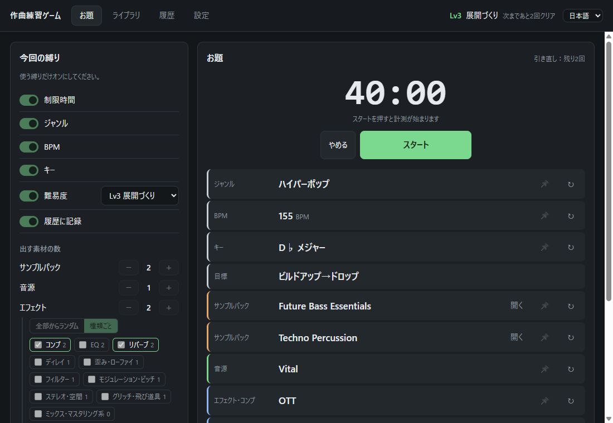
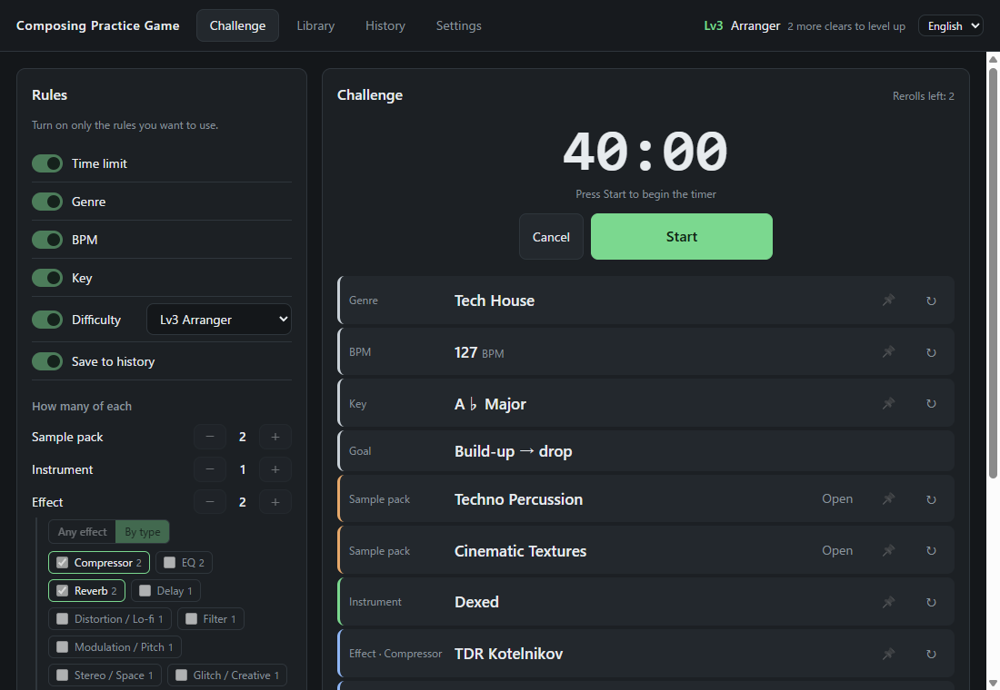

# 作曲練習ゲーム / Composing Practice Game

**日本語** | [English](#english)

PCに入っているサンプルパック・VST音源・エフェクトと、楽器パート・ジャンル・BPM・キーをランダムに出題して、「その縛りで1曲（または1ループ）作る」作曲練習ゲームです。いつも同じ音源・同じ流れで作ってしまう人が、手持ちの素材を使い切るためのツールです。

Windows 用のデスクトップアプリ（Electron）です。画面は日本語と英語を切り替えられます。

## できること

- **手持ちの素材から出題**：VSTフォルダとサンプルフォルダを自動でスキャンして、お題の候補にします。VST3 は中の情報から「音源 / エフェクト」とエフェクトの種類を判定し、分からないものは名前から推定します。
- **縛りを選べる**：制限時間・ジャンル・BPM・キー・難易度・履歴の記録を、それぞれオン/オフできます。
- **難易度（Lv1〜5）**：レベルが上がると、素材の数が増え、制限時間が短くなり、引き直しの回数が減ります。時間内に3回クリアすると次のレベルに上がります。
- **一部だけ自分で指定**：「サンプルパックだけ決めて、残りはランダム」のように、決めたい項目だけ指定できます。お題の 📌 で固定することもできます。
- **エフェクトを種類ごとに**：「全部からランダム」のほか、「コンプから1つ・EQから1つ・リバーブから1つ」のように種類ごとに出せます（コンプ / EQ / リバーブ / ディレイ / 歪み / フィルター / モジュレーション / ステレオ / グリッチ など12種類）。
- **引き直し**：気に入らない項目は ↻ で1つずつ引き直せます。
- **タイマーと小窓**：スタートで計測開始。「小さく表示」でDAWの横に置ける小さな窓（常に手前）になります。時間切れで音が鳴ります。
- **履歴**：完成したかは自己申告です。★の自己評価とメモをつけて記録でき、挑戦回数・クリア回数・合計時間などを見られます。最近出た素材は出にくくなります。

## 動かし方

必要なもの：Windows 10 / 11、[Node.js](https://nodejs.org/)（初回のセットアップで npm を使います）

1. このリポジトリをダウンロードします（緑の **Code** ボタン → **Download ZIP** で展開、または `git clone`）。
2. `起動.vbs` をダブルクリックします。
3. 初回だけ、Electron 本体を `%LOCALAPPDATA%\SakkyokuRenshuGame\runtime` に自動でダウンロードします（少し時間がかかります）。手動で入れる時は `setup.ps1` を実行します。
4. **設定** タブでサンプルフォルダを追加します（追加したフォルダの直下のフォルダ1つ＝サンプルパック1つ）。VSTフォルダは `C:\Program Files\Common Files\VST3` と `C:\Program Files\VSTPlugins` が最初から入っています。
5. **お題** タブで縛りを選んで **お題を引く** → **スタート**。

詳しい使い方は [使い方.md](使い方.md) を見てください。

## 言語

右上の選択欄で **日本語 / English** を切り替えられます。最初はPCの言語に合わせます。ジャンルとパートの候補を初期値のまま使っている場合は、それも切り替えた言語の初期値になります（自分で書き換えたものはそのまま残ります）。

## ファイル

| 場所 | 中身 |
| --- | --- |
| `起動.vbs` | 起動用 |
| `setup.ps1` | Electron 本体のセットアップ |
| `app/` | プログラム本体（外部ライブラリなし） |
| `app/renderer/i18n.js` | 画面の文言（日本語 / 英語） |
| `data/` | 設定・ライブラリ・履歴。起動すると作られます（リポジトリには含めていません） |

## ライセンス

[MIT License](LICENSE)

---

# Composing Practice Game

[日本語](#japanese) | **English**

A composing practice game that draws random challenges from what's actually on your PC: sample packs, VST instruments, effects, plus parts, genre, BPM and key. Your task is to make a track (or a loop) within those limits. It's meant for anyone who keeps reaching for the same instruments and the same workflow, and wants to actually use the stuff they own.

A Windows desktop app built with Electron. The interface can be switched between English and Japanese.

## Features

- **Challenges from your own library**: scans your VST and sample folders automatically. VST3 plugins are classified as instrument or effect (and by effect type) from their metadata; anything else is guessed from its name, and you can fix it in the Library tab.
- **Pick your rules**: time limit, genre, BPM, key, difficulty and history can each be turned on or off.
- **Difficulty (Lv1–5)**: higher levels mean more items, less time and fewer rerolls. Clear three challenges in time to level up.
- **Choose some items yourself**: e.g. pick the sample pack and leave everything else random. You can also pin (📌) an item from a challenge to keep it.
- **Effects by type**: draw from all effects, or one per type, such as one compressor, one EQ and one reverb. There are 12 types: compressor, EQ, reverb, delay, distortion, filter, modulation, stereo, glitch and more.
- **Rerolls**: reroll a single item with ↻.
- **Timer and mini window**: press Start to begin. "Mini window" shrinks the app to a small always-on-top window you can keep next to your DAW. A sound plays when time is up.
- **History**: you decide whether you finished. Rate yourself with stars, add notes, and see your total tries, clears and time. Recently used items show up less often.

## Getting started

Requirements: Windows 10 / 11 and [Node.js](https://nodejs.org/) (npm is used for the first-time setup).

1. Download this repository (green **Code** button → **Download ZIP** and extract it, or `git clone`).
2. Double-click `起動.vbs` (it means "launch").
3. The first time, Electron is downloaded automatically into `%LOCALAPPDATA%\SakkyokuRenshuGame\runtime`. This takes a moment. To install it manually, run `setup.ps1`.
4. In **Settings**, add your sample folders. Each folder directly inside an added folder counts as one sample pack. `C:\Program Files\Common Files\VST3` and `C:\Program Files\VSTPlugins` are included as VST folders by default.
5. In **Challenge**, pick your rules, press **Draw a challenge**, then **Start**.

## Language

Use the selector in the top-right corner to switch between **English** and **日本語**. On first launch it follows your system language. If you haven't edited the genre and part lists, they switch to that language's defaults too; lists you've edited are left as they are.

## Files

| Path | Contents |
| --- | --- |
| `起動.vbs` | Launcher |
| `setup.ps1` | Sets up the Electron runtime |
| `app/` | The app itself (no external libraries) |
| `app/renderer/i18n.js` | UI text (Japanese / English) |
| `data/` | Your settings, library and history. Created on first launch; not included in the repository |

The detailed manual ([使い方.md](使い方.md)) is in Japanese.

## License

[MIT License](LICENSE)
